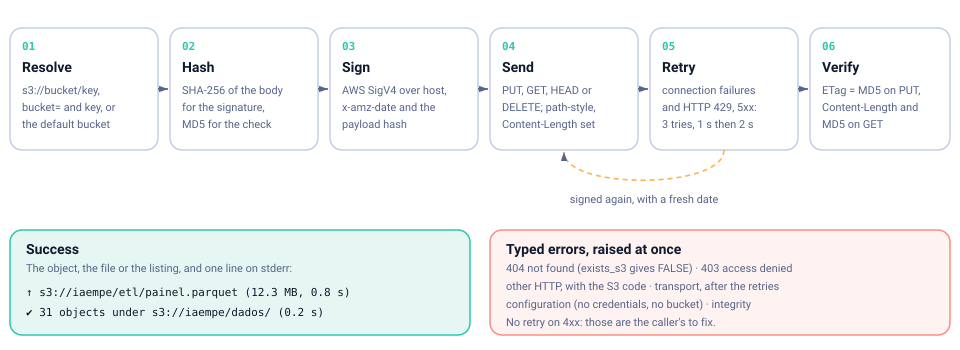
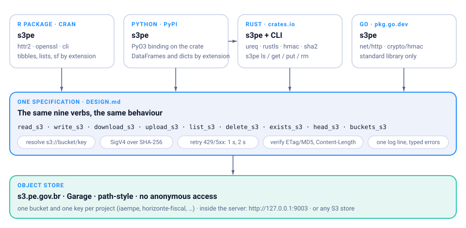

# s3pe 

<!-- badges: start -->
[](https://github.com/StrategicProjects/s3pe/actions/workflows/ci.yml)
[](https://CRAN.R-project.org/package=s3pe)
[](https://doi.org/10.5281/zenodo.23606939)
<!-- badges: end -->

A small, dependable client for S3-compatible object stores (AWS S3,
[MinIO](https://www.min.io/), [Garage](https://garagehq.deuxfleurs.fr), Ceph,
...), from R. Nine verbs, one configuration, nothing else to learn:

```r
library(s3pe)

use_endpoint("https://s3.example.org")
use_bucket("my-bucket")

meta <- read_s3("data/manifest.json")     # list, from JSON
sales <- read_s3("series/sales.csv.gz")   # tibble, from gzipped CSV
write_s3(sales, "report/sales.parquet")   # Parquet, by extension
list_s3("data/")
```

- **Format by extension**: `read_s3()` returns a tibble for `.csv`,
  `.csv.gz`, `.tsv`, `.parquet` and `.xlsx`, a list for `.json`, an sf
  object for `.geojson`, the saved object for `.rds`, a string for text
  and raw bytes for everything else. `write_s3()` does the reverse.
- **Signed, retried, verified**: every request carries an AWS Signature
  V4 over the real hash of the payload; connection failures and HTTP
  429/5xx are retried with exponential backoff; after every transfer the
  bytes are checked against the server's ETag and `Content-Length`.
- **Typed errors**: `s3pe_error_not_found`, `s3pe_error_access`,
  `s3pe_error_http`, `s3pe_error_transport`, `s3pe_error_integrity`,
  `s3pe_error_config`, all inheriting from `s3pe_error`.
- **One line per transfer** on the console via
  [cli](https://cli.r-lib.org), silenceable with
  `options(s3pe.quiet = TRUE)`.

The same package exists for
[Python](https://pypi.org/project/s3pe/),
[Rust](https://docs.rs/s3pe) (with a command line) and
[Go](https://pkg.go.dev/github.com/StrategicProjects/s3pe), all in the
[same repository](https://github.com/StrategicProjects/s3pe), with the
same verbs and the same behaviour.

## Installation

```r
# CRAN (once accepted)
install.packages("s3pe")

# Development version
pak::pak("StrategicProjects/s3pe/r")
```

## Configuration

Every request needs an endpoint and a key pair. Put them in `~/.Renviron`
(R reads it at start-up; never put a secret in a script or a versioned
`.Rprofile`) and restart R:

```
S3PE_ENDPOINT=https://s3.example.org
AWS_ACCESS_KEY_ID=...
AWS_SECRET_ACCESS_KEY=...
S3PE_BUCKET=my-bucket
```

`S3PE_BUCKET` is optional: it is the bucket used when a key is not an
`s3://bucket/key` URL and no `bucket` argument is given. For one session,
`use_endpoint()` and `use_bucket()` do the same. `s3_config()` shows what
was resolved (the secret is never printed); see `?s3_config` for the full
table (endpoint, region, timeout, retries).

```r
s3_config()
#> <s3pe_config>
#>   endpoint:   https://s3.example.org
#>   region:     us-east-1
#>   bucket:     my-bucket
#>   access_key: AKIA…
#>   secret_key: <set>
#>   timeout:    300 s
#>   max_tries:  3
```

| Setting | Option | Environment | Default |
|---|---|---|---|
| endpoint | `s3pe.endpoint` | `S3PE_ENDPOINT`, `AWS_ENDPOINT_URL` | required |
| region | `s3pe.region` | `AWS_REGION`, `AWS_DEFAULT_REGION` | `us-east-1` |
| credentials | | `AWS_ACCESS_KEY_ID`, `AWS_SECRET_ACCESS_KEY`, `AWS_SESSION_TOKEN` | required |
| bucket | `s3pe.bucket` | `S3PE_BUCKET` | none |
| timeout, max_tries | `s3pe.timeout`, `s3pe.max_tries` | | 300 s, 3 |

Requests are path-style (`endpoint/bucket/key`), which every
S3-compatible store accepts.

## Quick start

A good publisher writes a manifest last: if `manifest.json` is there,
everything it lists is there too. Read it first and use its date as the
version of the batch.

```r
library(s3pe)
library(dplyr)

use_bucket("my-bucket")

meta <- read_s3("data/manifest.json")
meta$generated_at

series  <- read_s3("data/series.json")
regions <- read_s3("data/regions.geojson")           # sf, when sf is installed
sales   <- read_s3("series/sales.csv.gz", col_types = "Dncl")

# another bucket on the same store: say so in the key
other <- read_s3("s3://other-bucket/series/prices.csv.gz")

list_s3("series/")
#> # A tibble: 12 × 4
#>    key                      size last_modified       etag
#>    <chr>                   <dbl> <dttm>              <chr>
#>  1 series/sales.csv.gz      2831 2026-10-23 07:01:12 9e10…
#>  …
```

Writing is the same in reverse:

```r
write_s3(panel, "report/panel.parquet")
#> ↑ s3://my-bucket/report/panel.parquet (12.3 MB, 0.8 s)

write_s3(list(generated_at = Sys.time(), rows = nrow(panel)),
         "report/manifest.json", pretty = TRUE)

upload_s3("output/figure1.png", "report/")           # keeps the file name
download_s3("data/regions.geojson", "data/regions.geojson")

exists_s3("report/panel.parquet")
head_s3("report/panel.parquet")
delete_s3("report/draft.csv")
```

Pass `format = ` when the extension does not say what you want
(`format = "raw"` always works), and `...` to reach the reader or writer
(`col_types`, `simplifyVector`, `pretty`, `na`, ...).

## Big files

Nothing to do: bodies larger than 64 MiB go up as a multipart upload
(16 MiB parts, one by one, aborted on any failure, every part's ETag
checked). Both knobs live in `s3_config(multipart_threshold =, part_size =)`
or in `S3PE_MULTIPART_THRESHOLD` and `S3PE_PART_SIZE`.

```r
upload_s3("exports/full.parquet", "archive/full.parquet", bucket = "my-bucket")
#> ↑ exports/full.parquet → s3://my-bucket/archive/full.parquet (1.2 GB, 48.3 s)
```

Uploads also take `metadata` (user metadata, returned by `head_s3()`) and
`headers` (any extra header: `Cache-Control`, `Content-Disposition`,
`x-amz-storage-class`, server-side encryption):

```r
write_s3(sales, "reports/sales.csv", bucket = "my-bucket",
         metadata = c(author = "ana", run = "2026-10-23"),
         headers = c("Cache-Control" = "max-age=3600"))
head_s3("reports/sales.csv", bucket = "my-bucket")$metadata[[1]]$author
#> [1] "ana"
```

## Pre-signed URLs

A link anyone can use for a while, without credentials:

```r
presign_s3("reports/report.pdf", bucket = "my-bucket", expires = 3600)
#> "https://s3.example.org/my-bucket/reports/report.pdf?X-Amz-Algorithm=..."
presign_s3("incoming/upload.csv", bucket = "my-bucket", method = "PUT")  # accept an upload
```

## Copy, delete, sync

```r
copy_s3("etl/sales.parquet", "archive/sales-2026.parquet", bucket = "my-bucket")
delete_s3(list_s3("tmp/", bucket = "my-bucket")$key, bucket = "my-bucket")  # one request
list_s3("series/", bucket = "my-bucket", delimiter = "/")                   # one level

# mirror a directory to a prefix, by ETag; the manifest goes up last
sync_up_s3("output/", "reports/2026/", bucket = "my-bucket",
           delete = TRUE, last = "manifest.json")
#> ✔ sync output/ → s3://my-bucket/reports/2026/: 12 uploaded, 30 unchanged, 0 deleted (3.2 s)
sync_down_s3("s3://my-bucket/reports/2026/", "reports-2026/")
```

## Errors

Network problems are errors, not warnings: a pipeline that depends on
the data should stop. Catch them by class when you want to go on:

```r
meta <- tryCatch(
  read_s3("data/manifest.json"),
  s3pe_error_not_found = function(e) NULL,
  s3pe_error_transport = function(e) { message("offline, using cache"); readRDS("cache.rds") }
)
```

| Class | When |
|---|---|
| `s3pe_error_config` | no endpoint, no credentials, no bucket |
| `s3pe_error_not_found` | HTTP 404 (`exists_s3()` and `head_s3()` turn it into `FALSE`/`NULL`) |
| `s3pe_error_access` | HTTP 403 |
| `s3pe_error_http` | any other HTTP error, with `$status` and `$code` |
| `s3pe_error_transport` | the server could not be reached, after the retries |
| `s3pe_error_integrity` | the bytes that arrived are not the bytes that were sent |

## What happens in every call



## Architecture



## Em português

`s3pe` lê e grava dados em qualquer armazenamento de objetos compatível
com S3 a partir do R: `read_s3()` e `write_s3()` escolhem o formato pela
extensão do arquivo (`.csv`, `.json`, `.parquet`, `.rds`, `.geojson`),
`upload_s3()` e `download_s3()` movem arquivos, `list_s3()`, `head_s3()`,
`exists_s3()` e `delete_s3()` cuidam do resto. O endpoint e as credenciais
ficam no `~/.Renviron` (`S3PE_ENDPOINT`, `AWS_ACCESS_KEY_ID`,
`AWS_SECRET_ACCESS_KEY`), nunca em scripts. Toda requisição é assinada,
repetida em falhas transitórias e conferida pelo ETag. As mensagens e a
documentação estão em inglês, como nos pacotes irmãos.

## Related

- The Python, Rust and Go editions, in the
  [same repository](https://github.com/StrategicProjects/s3pe).
- [aws.s3](https://github.com/cloudyr/aws.s3) and
  [paws](https://www.paws-r-sdk.com/): general AWS clients. `s3pe` is
  smaller, picks the format from the extension, verifies every transfer
  and never sends the `aws-chunked` encoding that some stores reject.
- Other packages by the same authors:
  [alepe](https://github.com/StrategicProjects/alepe),
  [tceper](https://github.com/StrategicProjects/tceper),
  [ibger](https://github.com/ropensci/ibger).

## Made in Pernambuco 🌵

s3pe is developed in Recife, Brazil, by the authors listed in
`DESCRIPTION`.
