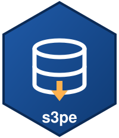

# s3pe 

<!-- badges: start -->
[](https://github.com/StrategicProjects/s3pe/actions/workflows/ci.yml)
[](https://CRAN.R-project.org/package=s3pe)
<!-- badges: end -->

Read and write data on the S3 object store of the State of Pernambuco,
Brazil (`s3.pe.gov.br`, a [Garage](https://garagehq.deuxfleurs.fr) server),
or on any other S3-style store, from R. Nine verbs, one configuration,
nothing else to learn:

```r
library(s3pe)

meta <- read_s3("dados/metadata.json", bucket = "iaempe")
write_s3(mtcars, "nota_tecnica/mtcars.csv", bucket = "iaempe")
list_s3("dados/", bucket = "iaempe")
```

- **Format by extension**: `read_s3()` returns a tibble for `.csv`,
  `.csv.gz`, `.tsv`, `.parquet` and `.xlsx`, a list for `.json`, an sf
  object for `.geojson`, the saved object for `.rds`, a string for text
  and raw bytes for everything else. `write_s3()` does the reverse.
- **Signed, retried, verified**: every request carries an AWS Signature
  V4 over the real hash of the payload; connection failures and HTTP
  429/5xx are retried with exponential backoff; after every transfer the
  bytes are checked against the server's ETag and `Content-Length`.
- **Typed errors**: `s3pe_error_not_found`, `s3pe_error_access`,
  `s3pe_error_http`, `s3pe_error_transport`, `s3pe_error_integrity`,
  `s3pe_error_config`, all inheriting from `s3pe_error`.
- **One line per transfer** on the console via
  [cli](https://cli.r-lib.org), silenceable with
  `options(s3pe.quiet = TRUE)`.

The same package exists for
[Python](https://pypi.org/project/s3pe/),
[Rust](https://crates.io/crates/s3pe) (with a command line) and
[Go](https://pkg.go.dev/github.com/StrategicProjects/s3pe), all in the
[same repository](https://github.com/StrategicProjects/s3pe), with the
same verbs and the same behaviour.

## Installation

```r
# CRAN (once accepted)
install.packages("s3pe")

# Development version
pak::pak("StrategicProjects/s3pe/r")
```

## Credentials

There is no anonymous access: every request is signed. Put the key pair
in `~/.Renviron` (R reads it at start-up; never put it in a script or a
versioned `.Rprofile`):

```
AWS_ACCESS_KEY_ID=GK...
AWS_SECRET_ACCESS_KEY=...
S3PE_BUCKET=iaempe
```

Restart R. `S3PE_BUCKET` is optional: it is the bucket used when a key is
not an `s3://bucket/key` URL and no `bucket` argument is given. Everything
else has a default that fits `s3.pe.gov.br`; see `?s3_config` for the
full table (endpoint, region, timeout, retries).

```r
s3_config()
#> <s3pe_config>
#>   endpoint:   https://s3.pe.gov.br
#>   region:     us-east-1
#>   bucket:     iaempe
#>   access_key: GK40…
#>   secret_key: <set>
#>   timeout:    300 s
#>   max_tries:  3
```

## Quick start

The buckets of the platform publish a manifest last (`metadata.json`,
`manifest.json`): if it is there, everything it lists is there too. Read
it first and use its date as the version of the batch.

```r
library(s3pe)
library(dplyr)

# the IAEM-PE dashboard batch
meta <- read_s3("dados/metadata.json", bucket = "iaempe")
meta$ultimo_mes
#> [1] 202608

# or set the bucket once and use bare keys from then on
use_bucket("iaempe")
series  <- read_s3("dados/series.json")
ranking <- read_s3("dados/ranking.json")

# GeoJSON comes back as sf when sf is installed
municipios <- read_s3("dados/pe_municipios.geojson", bucket = "iaempe")

# the fiscal series of Horizonte Fiscal: gzipped CSV, one row per month
manifest <- read_s3("s3://horizonte-fiscal/manifest.json")
icms <- read_s3("s3://horizonte-fiscal/series/estado/icms.csv.gz",
                col_types = "Dncl")
fpm_recife <- read_s3("s3://horizonte-fiscal/series/municipios/2611606/fpm.csv.gz")

# what is there
list_s3("series/municipios/2611606/", bucket = "horizonte-fiscal")
#> # A tibble: 12 × 4
#>    key                                       size last_modified       etag
#>    <chr>                                    <dbl> <dttm>              <chr>
#>  1 series/municipios/2611606/fpm.csv.gz      2831 2026-10-23 07:01:12 9e10…
#>  …
```

Writing is the same in reverse. Use your own prefix: `dados/` belongs to
the automatic mirror.

```r
write_s3(painel, "nota_tecnica/painel.parquet", bucket = "iaempe")
#> ↑ s3://iaempe/nota_tecnica/painel.parquet (12.3 MB, 0.8 s)

write_s3(list(gerado_em = Sys.time(), linhas = nrow(painel)),
         "nota_tecnica/manifest.json", bucket = "iaempe", pretty = TRUE)

upload_s3("output/figura1.png", "nota_tecnica/", bucket = "iaempe")
download_s3("dados/pe_municipios.geojson", "data/pe_municipios.geojson",
            bucket = "iaempe")

exists_s3("nota_tecnica/painel.parquet", bucket = "iaempe")
head_s3("nota_tecnica/painel.parquet", bucket = "iaempe")
delete_s3("nota_tecnica/rascunho.csv", bucket = "iaempe")
```

Pass `format = ` when the extension does not say what you want
(`format = "raw"` always works), and `...` to reach the reader or writer
(`col_types`, `simplifyVector`, `pretty`, `na`, ...).

## Inside the condepe server

The server that hosts the store reaches it without the public endpoint:

```r
options(s3pe.endpoint = "http://127.0.0.1:9003")
```

## Errors

Network problems are errors, not warnings: a pipeline that depends on
the data should stop. Catch them by class when you want to go on:

```r
meta <- tryCatch(
  read_s3("dados/metadata.json", bucket = "iaempe"),
  s3pe_error_not_found = function(e) NULL,
  s3pe_error_transport = function(e) { message("offline, using cache"); readRDS("cache.rds") }
)
```

| Class | When |
|---|---|
| `s3pe_error_config` | no credentials, no bucket, bad endpoint |
| `s3pe_error_not_found` | HTTP 404 (`exists_s3()` and `head_s3()` turn it into `FALSE`/`NULL`) |
| `s3pe_error_access` | HTTP 403 |
| `s3pe_error_http` | any other HTTP error, with `$status` and `$code` |
| `s3pe_error_transport` | the server could not be reached, after the retries |
| `s3pe_error_integrity` | the bytes that arrived are not the bytes that were sent |

## Em português

`s3pe` lê e grava dados no armazenamento S3 do Estado de Pernambuco
(`s3.pe.gov.br`) a partir do R: `read_s3()` e `write_s3()` escolhem o
formato pela extensão do arquivo (`.csv`, `.json`, `.parquet`, `.rds`,
`.geojson`), `upload_s3()` e `download_s3()` movem arquivos, `list_s3()`,
`head_s3()`, `exists_s3()` e `delete_s3()` cuidam do resto. As credenciais
ficam no `~/.Renviron` (`AWS_ACCESS_KEY_ID`, `AWS_SECRET_ACCESS_KEY`),
nunca em scripts. Toda requisição é assinada, repetida em falhas
transitórias e conferida pelo ETag. As mensagens e a documentação estão em
inglês, como nos pacotes irmãos.

## Related

- The Python, Rust and Go editions, in the
  [same repository](https://github.com/StrategicProjects/s3pe).
- [aws.s3](https://github.com/cloudyr/aws.s3) and
  [paws](https://www.paws-r-sdk.com/): general AWS clients. `s3pe` is
  smaller, has the Pernambuco defaults built in and never sends the
  `aws-chunked` encoding that Garage rejects.
- The sibling packages for Brazilian public data by the same authors:
  [alepe](https://github.com/StrategicProjects/alepe),
  [tceper](https://github.com/StrategicProjects/tceper),
  [ibger](https://github.com/ropensci/ibger).
